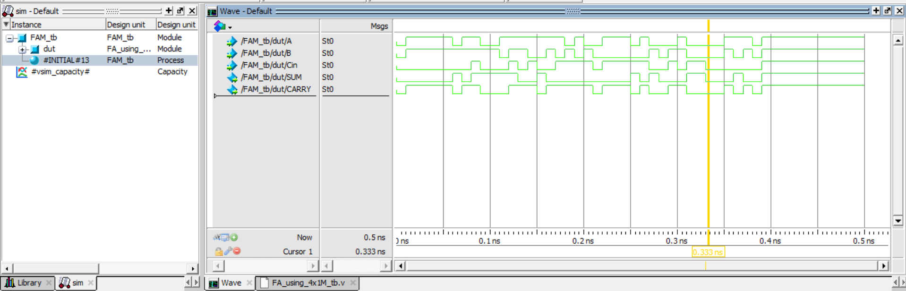

# Design and Verification of Full Adder Using 4:1 Multiplexers in Verilog HDL

<h1 align="center">
  Design and Verification of Full Adder Using 4:1 Multiplexers in Verilog HDL
</h1>

<p align="center">
  <b>Verilog HDL | ModelSim 2020.1 | GVim</b>
</p>

---

## 1. Project Overview

This project focuses on the design and functional verification of a **1-bit Full Adder using 4:1 Multiplexers** in Verilog Hardware Description Language (HDL).

A Full Adder is a combinational logic circuit that performs the addition of three single-bit inputs: A, B, and Carry-in (Cin). It generates two outputs: SUM and CARRY.

In this implementation, two 4:1 Multiplexers are used to realize the Full Adder functionality. One multiplexer generates the SUM output, while the other generates the CARRY output.

The design is verified using a Verilog testbench that applies randomly generated input combinations. Functional simulation is performed using ModelSim 2020.1, and the output waveforms are analyzed to verify the design.

## 2. Objectives

- To understand the working principle of a 1-bit Full Adder.
- To design a 4:1 Multiplexer using Verilog HDL.
- To implement Full Adder functionality using two 4:1 Multiplexers.
- To generate SUM and CARRY outputs using multiplexer-based logic.
- To develop a testbench for functional verification.
- To apply randomized input combinations using `$urandom`.
- To simulate and analyze the design using ModelSim.

## 3. Tools and Technologies Used

| Tool / Technology | Description |
|:---|:---|
| Verilog HDL | Hardware Description Language |
| ModelSim 2020.1 | Compilation and functional simulation |
| GVim | Verilog source-code editor |
| Windows / Linux | Development environment |

## 4. Repository Structure

```text
Full-Adder-Using-4x1-Multiplexer/
│
├── FA_4M.V
├── FA_using_4x1M_tb.v
├── run.do
├── Waveform.png
└── README.md
```

| File Name | Description |
|:---|:---|
| `FA_4M.V` | Verilog design containing the 4:1 MUX and Full Adder modules |
| `FA_using_4x1M_tb.v` | Testbench for functional verification |
| `run.do` | ModelSim compilation and simulation script |
| `Waveform.png` | ModelSim simulation waveform |
| `README.md` | Project documentation |

## 5. Theoretical Background

### 5.1 Full Adder

A Full Adder is a combinational logic circuit that adds three 1-bit binary inputs:

- A: First input bit
- B: Second input bit
- Cin: Carry input from the previous stage

It produces two outputs:

- SUM: Result of binary addition
- CARRY: Carry output to the next stage

### 5.2 Full Adder Truth Table

| A | B | Cin | SUM | CARRY |
|:---:|:---:|:---:|:---:|:---:|
| 0 | 0 | 0 | 0 | 0 |
| 0 | 0 | 1 | 1 | 0 |
| 0 | 1 | 0 | 1 | 0 |
| 0 | 1 | 1 | 0 | 1 |
| 1 | 0 | 0 | 1 | 0 |
| 1 | 0 | 1 | 0 | 1 |
| 1 | 1 | 0 | 0 | 1 |
| 1 | 1 | 1 | 1 | 1 |

### 5.3 Boolean Expressions

The SUM output is given by:

\[
SUM=A\oplus B\oplus Cin
\]

The CARRY output is given by:

\[
CARRY=AB+BCin+ACin
\]

Where:

- \(\oplus\) represents XOR operation.
- \(+\) represents OR operation.
- Multiplication represents AND operation.

## 6. 4:1 Multiplexer

A 4:1 Multiplexer is a combinational circuit that selects one of four input signals based on two select lines.

It consists of:

- Four data inputs: I0, I1, I2, I3
- Two select inputs: S0, S1
- One output: Y

### 6.1 Selection Table

| S1 | S0 | Selected Input |
|:---:|:---:|:---|
| 0 | 0 | I0 |
| 0 | 1 | I1 |
| 1 | 0 | I2 |
| 1 | 1 | I3 |

### 6.2 Multiplexer Implementation

The 4:1 MUX is implemented in Verilog using a conditional operator:

```verilog
assign Y=(S[1]?(S[0]?I[3]:I[2]):(S[0]?I[1]:I[0]));
```

This statement selects one of the four inputs depending on the values of the select lines.

## 7. Full Adder Implementation Using 4:1 MUX

In this project, two 4:1 Multiplexers are used to implement the Full Adder.

The inputs A and B are connected to the select lines of both multiplexers.

### 7.1 SUM Generation

The SUM output is generated using the following MUX input configuration:

| Select A | Select B | Selected Input | SUM |
|:---:|:---:|:---:|:---:|
| 0 | 0 | I0 = Cin | Cin |
| 0 | 1 | I1 = ~Cin | ~Cin |
| 1 | 0 | I2 = ~Cin | ~Cin |
| 1 | 1 | I3 = Cin | Cin |

Therefore, the SUM output is:

\[
SUM=A\oplus B\oplus Cin
\]

### 7.2 CARRY Generation

The CARRY output is generated using the following MUX input configuration:

| Select A | Select B | Selected Input | CARRY |
|:---:|:---:|:---:|:---:|
| 0 | 0 | I0 = 0 | 0 |
| 0 | 1 | I1 = Cin | Cin |
| 1 | 0 | I2 = Cin | Cin |
| 1 | 1 | I3 = 1 | 1 |

Therefore, the CARRY output is:

\[
CARRY=AB+BCin+ACin
\]

## 8. Verilog HDL Design

### 8.1 Source Code: `FA_4M.V`

```verilog
module MUX_4x1(I,S,Y);

input [3:0] I;
input [1:0] S;
output Y;

assign Y=(S[1]?(S[0]?I[3]:I[2]):(S[0]?I[1]:I[0]));

endmodule


module FA_using_4X1M(A,B,Cin,SUM,CARRY);

input A,B,Cin;
output SUM,CARRY;

MUX_4x1 fa1({Cin,(~Cin),(~Cin),Cin},{A,B},SUM);

MUX_4x1 fa2({1'b1,Cin,Cin,1'b0},{A,B},CARRY);

endmodule
```

### 8.2 Code Explanation

| Code Component | Description |
|:---|:---|
| `MUX_4x1` | Defines the 4:1 Multiplexer module |
| `input [3:0] I` | Declares four data inputs |
| `input [1:0] S` | Declares two select lines |
| `assign Y` | Selects the required input using conditional operators |
| `FA_using_4X1M` | Defines the Full Adder module |
| `fa1` | 4:1 MUX instance used for SUM generation |
| `fa2` | 4:1 MUX instance used for CARRY generation |

## 9. Testbench Implementation

A testbench is developed to verify the functionality of the Full Adder.

The testbench applies randomly generated values to inputs A, B, and Cin using the Verilog system function `$urandom`.

A total of 40 input combinations are generated, with a delay of 10 simulation time units between successive input applications.

### 9.1 Testbench Code: `FA_using_4x1M_tb.v`

```verilog
`include "FA_4M.V"

module FAM_tb;

wire SUM,CARRY;
reg A,B,Cin;

FA_using_4X1M dut(A,B,Cin,SUM,CARRY);

initial begin

    repeat(40) begin

        {A,B,Cin}=$urandom;

        #10;

        $display("A=%B B=%b Cin=%b SUM=%b CARRY=%b",
                  A,B,Cin,SUM,CARRY);

    end

end

initial begin

    #500;
    $finish;

end

endmodule
```

### 9.2 Testbench Description

| Testbench Statement | Function |
|:---|:---|
| `include "FA_4M.V"` | Includes the Full Adder design file |
| `FAM_tb` | Declares the testbench module |
| `reg A,B,Cin` | Declares input stimulus signals |
| `wire SUM,CARRY` | Declares output signals |
| `FA_using_4X1M dut(...)` | Instantiates the Full Adder |
| `repeat(40)` | Repeats the input-generation process 40 times |
| `$urandom` | Generates randomized input values |
| `#10` | Adds a delay of 10 simulation time units |
| `$display` | Displays input and output values in the transcript |
| `$finish` | Terminates the simulation |

## 10. ModelSim Simulation Setup

### 10.1 Simulation Script: `run.do`

The following commands are used to compile and simulate the design.

```tcl
# compilation
vlog FA_using_4x1M_tb.v -l comp.log

# elaboration
vsim -voptargs=+acc FAM_tb

# addwave
add wave sim:/FAM_tb/dut/*

# run
run -all
```

### 10.2 Command Description

| Command | Function |
|:---|:---|
| `vlog` | Compiles the Verilog testbench |
| `-l comp.log` | Saves compilation messages in a log file |
| `vsim` | Loads the testbench for simulation |
| `-voptargs=+acc` | Enables access to internal design objects |
| `add wave` | Adds Full Adder signals to the waveform window |
| `run -all` | Executes the simulation until completion |

## 11. Simulation Results

The Full Adder design was simulated using ModelSim 2020.1. Randomized input combinations were applied to verify the SUM and CARRY outputs.

### 11.1 ModelSim Simulation Waveform

The following waveform shows the input signals A, B, and Cin, along with the corresponding SUM and CARRY outputs.

<p align="center">
  
</p>

<p align="center">
  <b>Figure 1: ModelSim Simulation Waveform of Full Adder Using 4:1 Multiplexers.</b>
</p>

### 11.2 Simulation Signal Analysis

| Signal | Description |
|:---|:---|
| `A` | First input bit |
| `B` | Second input bit |
| `Cin` | Carry input |
| `SUM` | Sum output generated by the first 4:1 MUX |
| `CARRY` | Carry output generated by the second 4:1 MUX |

### 11.3 Functional Verification

The Full Adder functionality is verified by checking the SUM and CARRY outputs for the applied input combinations.

| A | B | Cin | Expected SUM | Expected CARRY |
|:---:|:---:|:---:|:---:|:---:|
| 0 | 0 | 0 | 0 | 0 |
| 0 | 0 | 1 | 1 | 0 |
| 0 | 1 | 0 | 1 | 0 |
| 0 | 1 | 1 | 0 | 1 |
| 1 | 0 | 0 | 1 | 0 |
| 1 | 0 | 1 | 0 | 1 |
| 1 | 1 | 0 | 0 | 1 |
| 1 | 1 | 1 | 1 | 1 |

The waveform shows the applied input transitions and corresponding output transitions. The output logic is designed to follow the Full Adder truth table.

## 12. Key Observations

- A 4:1 Multiplexer is implemented using Verilog conditional operators.
- Two 4:1 Multiplexers are used to realize the Full Adder.
- The first MUX generates the SUM output.
- The second MUX generates the CARRY output.
- The testbench applies randomized input combinations using `$urandom`.
- The output signals are observed using the ModelSim waveform window.
- The design demonstrates the implementation of combinational logic using multiplexers.

## 13. Applications

The concepts demonstrated in this project are useful for understanding:

- Combinational logic design.
- Multiplexer-based logic implementation.
- Arithmetic circuit design.
- Full Adder and multi-bit adder architectures.
- Verilog HDL design and functional verification.
- Testbench development and waveform analysis.

## 14. Learning Outcomes

Through this project, I explored:

- Design of a 4:1 Multiplexer using Verilog HDL.
- Implementation of a Full Adder using multiplexers.
- Boolean logic realization using MUX-based architecture.
- Verilog module instantiation.
- Randomized stimulus generation using `$urandom`.
- Functional verification using a testbench.
- ModelSim compilation, simulation, and waveform analysis.

## 15. Conclusion

A 1-bit Full Adder was designed and implemented using two 4:1 Multiplexers in Verilog HDL.

The first multiplexer generates the SUM output, while the second generates the CARRY output. A testbench was developed to apply randomized input combinations and verify the functional behaviour of the design using ModelSim 2020.1.

This project provided practical understanding of multiplexer-based combinational logic design, arithmetic circuit implementation, and functional verification using Verilog HDL.

---

**Project Category:** Digital Design and Functional Verification

**Tools Used:** Verilog HDL | ModelSim 2020.1 | GVim
